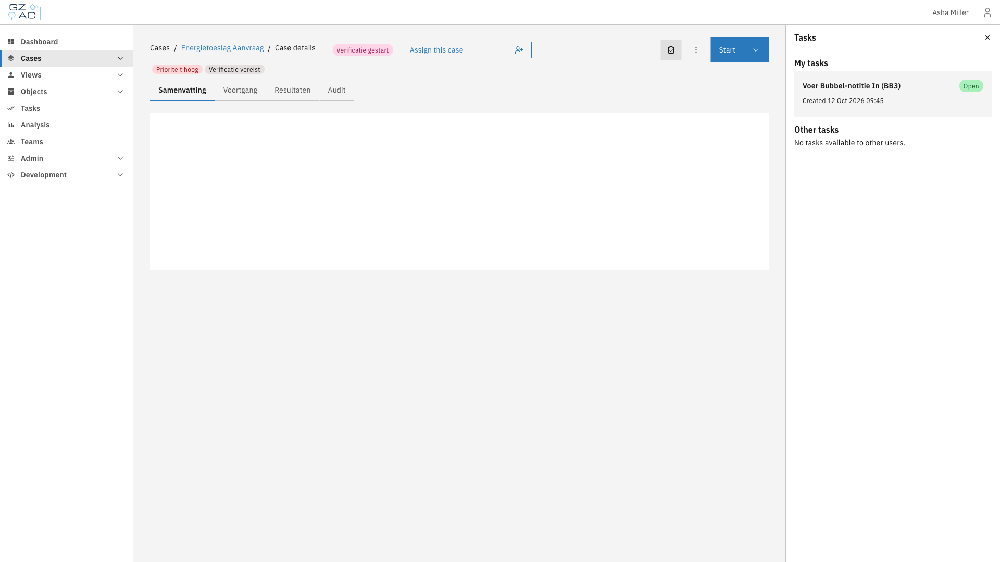
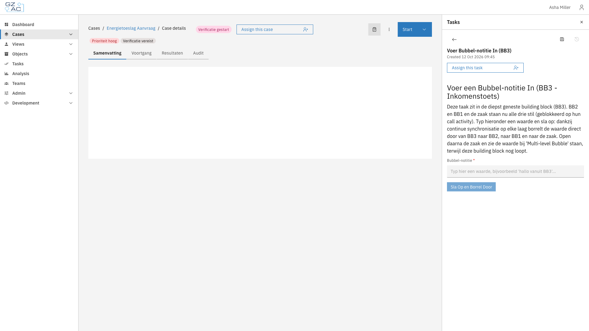

# What is the side panel?

The side panel is an area at the right edge of the screen, below the header. It shows supporting content, such as the tasks of a case or a screen from an external plugin, next to the page the user is working on. The page moves aside to make room, so nothing is covered.

The side panel lets users:

- Work on a task while the case details stay visible
- Keep supporting content at hand while moving through the application
- Find supporting content in the same place on every page

## How the side panel works

### Tasks on a case

On a case's detail page, the side panel shows the tasks of the case. Clicking a task opens it in the panel; the back arrow returns to the task list.

<figure><figcaption>Case details with the task list in the side panel</figcaption></figure>

<figure><figcaption>A task form opened in the side panel</figcaption></figure>

Two settings decide what appears in the panel:

- **Task list visible on tab** on a case tab decides on which tabs the task list is available. See [Tabs](../configuration-guides/cases/case-details/tabs.md).
- The **form display type** of a process link decides where a form opens: **Panel** opens it in the side panel, **Modal** opens it in a dialog. This applies to task forms and start forms.

The tasks button in the case header shows or hides the panel. A form that is open in the panel stays open when the user switches tabs. Leaving the case with unsaved changes in a form asks for confirmation first.

### Content from external plugins

External plugins can show their own content in the side panel. The panel header names the case the content belongs to and links back to it. On any other page, the case is marked **Not this page**.

Content marked with a pin stays open when the user goes to other pages. The plugin or feature that shows the content decides whether to pin it.

### Size and closing

Users resize the panel by dragging its left edge. The width is remembered: per user for the task panel, per browser for other content. On small screens, the panel overlays the page instead of pushing it aside.

The close button hides the panel without discarding its content.

## Relationship to other concepts

- **[Cases](case.md)**: the case detail page shows its tasks in the side panel
- **[Processes](process.md)**: the form display type of a process link decides whether a form opens in the side panel
- **[External plugins](external-plugins.md)**: plugins can offer content to the side panel

## Learn more

- [Configuration guide: Case detail tabs](../configuration-guides/cases/case-details/tabs.md)
- [Configuration guide: External plugins in cases and processes](../configuration-guides/plugins/external-plugins/external-plugins-in-cases-and-processes.md)
